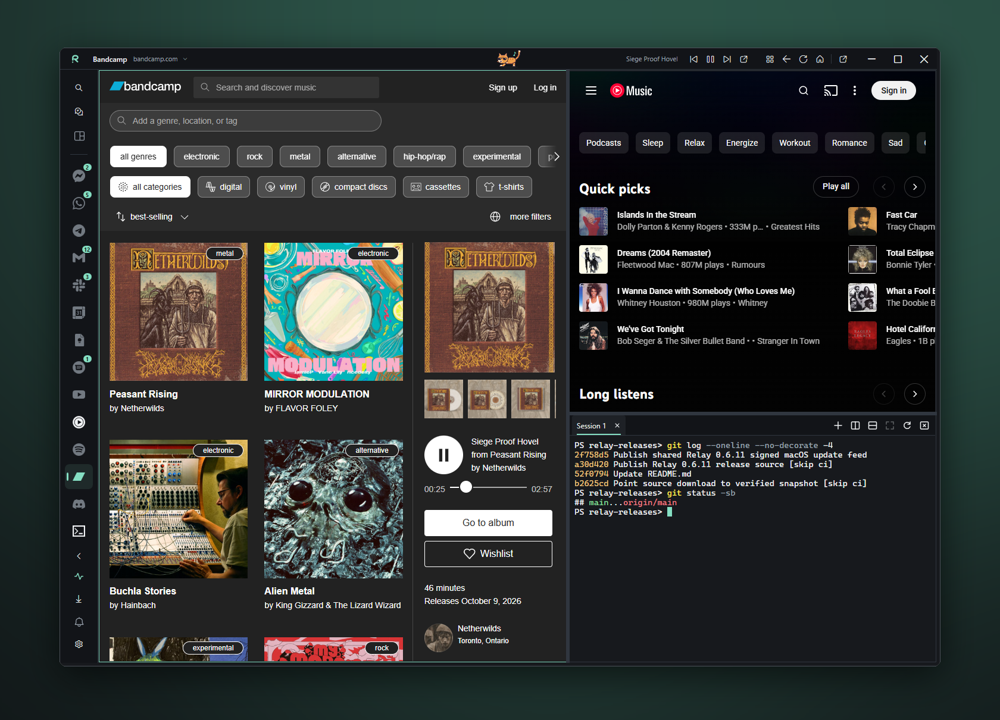
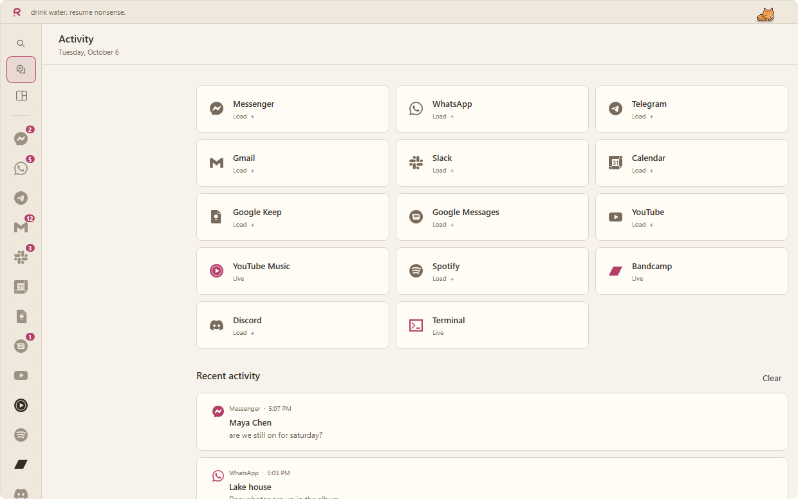
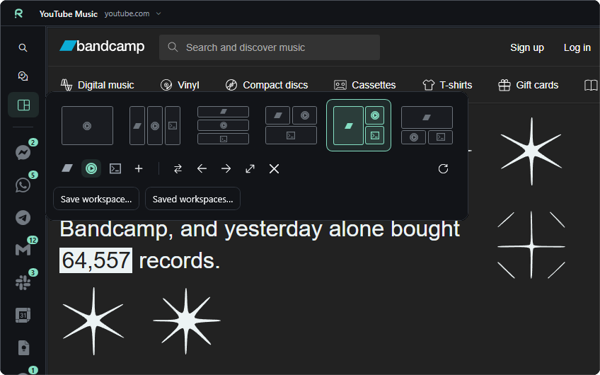
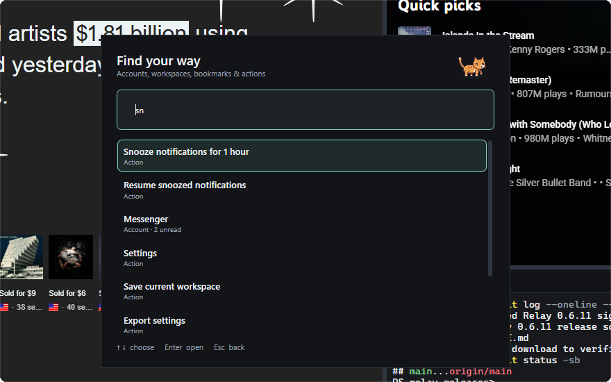
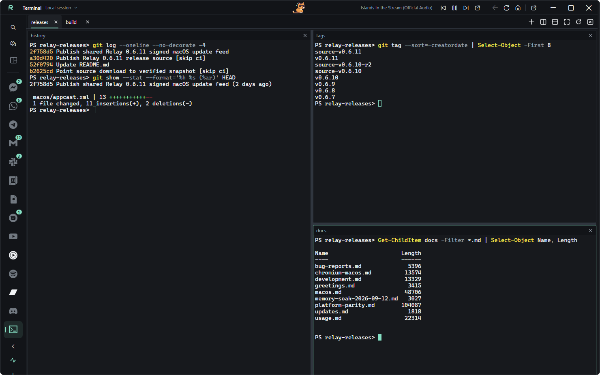
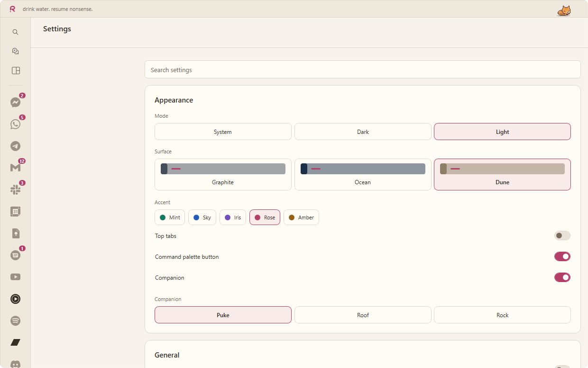
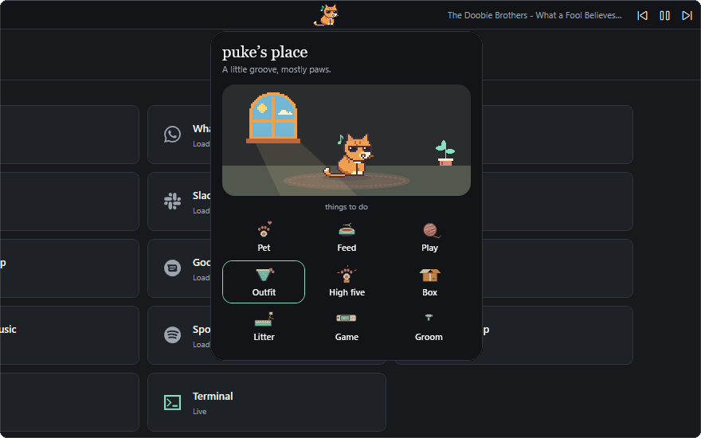
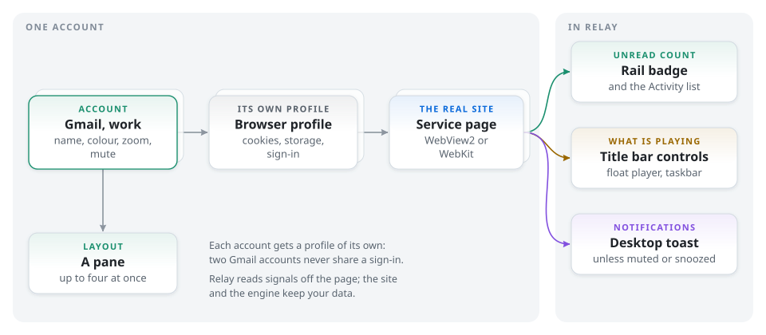
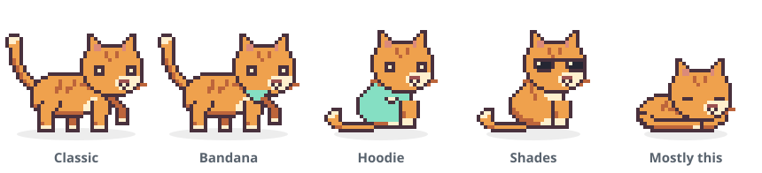

<picture>
  <source media="(prefers-color-scheme: dark)" srcset="docs/puke/puke-hello-dark.svg">
  
</picture>

# Relay

**Chats, mail and music in one window, for Windows and macOS.**
 Explained by a cat who doesn't totally get it.

**[Download for Windows](https://github.com/chungus-actual/relay-releases/releases/latest)** ·
**[Download for macOS](https://github.com/chungus-actual/relay-releases/releases/tag/macos-0.6.12-29)**

---

## Okay. I asked around.

I'm Puke. I live up top, by the buttons. I don't know what most of the buttons do, but I sit near
them, which is basically the same thing.

You keep all your chats and your mail and your music in about a hundred browser tabs. I've watched
you do it. It's embarrassing for both of us. Relay puts them in one window: Messenger, WhatsApp,
Telegram, Gmail, Slack, Discord, Google Calendar, Keep and Messages, plus YouTube, YouTube Music,
Spotify, Bandcamp and a terminal. I don't know what a terminal is. I think it's where the cursor lives.

Every account keeps its own sign-in. All the unread stuff shows up in one spot, you can put apps side
by side, and the music buttons follow whatever's playing. I also follow whatever's playing. With my eyes
closed.

  
   Bandcamp, YouTube Music and a terminal at the same time. I was asleep for this photo.

## Contents

[Stuff I've seen](#stuff-ive-seen) · [What it does](#what-it-does) · [Apps](#apps) ·
[How it works](#how-it-works) · [Me](#me) · [Install](#install) · [Updates](#updates) ·
[Keyboard](#keyboard) · [Privacy](#privacy) · [If it breaks](#if-it-breaks) ·
[Source](#source) · [Notices](#notices)

## Stuff I've seen

| | |
|:---:|:---:|
|  <b>Activity.</b> Everybody who's talking to you, in one grid. Nobody is talking to me. That's fine |  <b>Layouts.</b> Up to four apps at once. I can look at one thing at a time and it's usually the wall |
|  <b>Command palette.</b> You press Ctrl+K and type a word and it just goes there. Witchcraft |  <b>Terminal.</b> Tabs and splits, next to everything else. So many words. I don't trust it |
|  <b>Themes.</b> Light, dark, three surfaces, five accent colors. My bandana changes color too. Nobody asked me |  <b>My room.</b> You click me and you're in it. You could knock first. You can't knock |

Screenshots are from Windows with a fresh profile. The unread counts are pretend. I counted them anyway.

## What it does

Here's a big table. I didn't read it. It's correct though.

| | |
|---|---|
| **Unread in one place** | Each account shows a badge on the rail, and Activity lists recent notifications from all of them. Dismissing one in Relay doesn't mark it read on the site |
| **More than one account** | Add a second Gmail or WhatsApp with its own sign-in, cookies, zoom, notifications and audio. Give any account its own name and an identity color |
| **Layouts** | Up to four apps side by side, stacked, in a grid, or one big pane with the rest beside it. Drag the dividers; Relay remembers the arrangement. Save up to 32 named workspaces |
| **Playback controls** | Play, pause and skip YouTube, YouTube Music, Spotify and Bandcamp from the title bar, whichever app you're looking at. On Windows the taskbar thumbnail has the same buttons |
| **Float player** | Move a playing app into its own window that stays above everything else, with play/pause, full screen and dock |
| **Pop-out windows** | Open any account in its own Relay window and dock it back later, with its sign-in and page intact |
| **Command palette** | Ctrl+K (Cmd+K on a Mac) finds accounts, workspaces, bookmarks and actions. Bookmarks always open in the account that saved them |
| **Terminal** | PowerShell on Windows and your login shell on macOS, with up to 16 tabs and four splits per tab. On macOS it can copy fonts and colors from an iTerm2, Terminal or Ghostty profile |
| **Quiet when you need it** | Mute notifications, or snooze them for 30 minutes, an hour, eight hours or until 9 tomorrow, for everything or one account. Snooze is my favorite button |
| **Background sleep** | Let accounts you aren't using sleep in the background. Playing media and active downloads keep an account awake. The pulse icon on the rail shows CPU and memory use |
| **Downloads** | Files from every app land in one searchable list, kept across restarts |
| **Settings that travel** | Export your accounts, layouts and bookmarks to a file and import it on either platform. Sign-ins aren't included |
| **Themes** | Light, dark or follow the system, with three surfaces (Graphite, Ocean, Dune) and five accents |
| **Companion** | A cat, a dog or a rock in the title bar. Pick the cat. The dog is a lot. The rock has never done anything |
| **Problem reports** | Ctrl+Shift+B (Cmd+Shift+B) builds a report with recent diagnostic events and an optional screenshot, saved as a file for you to look over and send |

## Apps

The ones I watch you use:

| | |
|---|---|
| **Chat** | Messenger, WhatsApp, Telegram, Slack, Discord, Google Messages |
| **Mail and planning** | Gmail, Google Calendar, Google Keep |
| **Music and video** | YouTube, YouTube Music, Spotify, Bandcamp, with play and pause up in the title bar next to me. I don't press them. Usually |
| **Local** | Terminal |

A fresh profile starts with every app unloaded; click one to load it. To add another account of the
same app, right-click its icon and choose Add account, or use Settings > Add account.

Badges come from what each site shows: the count in its page title, or for Messenger and Gmail, the
unread markers on the page. A site that shows no count can have unread messages without a badge. Not
my fault. I was asleep.

## How it works

Every account is that app's real website, running in its own little browser box: WebView2 on Windows,
WebKit on macOS. Relay just peeks at it to see the unread count and what's playing, and leaves the
sign-ins, messages and storage alone. It's like me watching a bird through the window. The bird
doesn't know. The bird is Gmail.

<picture>
  <source media="(prefers-color-scheme: dark)" srcset="docs/diagrams/account-model-dark.svg">
  
</picture>

The terminal is the weird one: it's a real shell running on your computer, PowerShell on Windows or
your login shell on macOS. It keeps running when you switch apps and stops when you unload it or quit
Relay. Like a cat that won't get off the counter.

## Me

The important part.

I'm off by default. Rude. Turn me on in **Settings > Appearance > Companion** and pick **Puke**. You
could pick Roof instead, who is a dog and has a lot of feelings, or Rock, who is a rock. Only one of
us fits up there.

<picture>
  <source media="(prefers-color-scheme: dark)" srcset="docs/puke/puke-looks-dark.svg">
  
</picture>

| | |
|---|---|
| **What I do** | Sleep. Every couple of minutes, something else. If music comes on I might wave or bob my head. I might also keep sleeping. Don't take it personally |
| **My room** | Click me. There's Pet, Feed, Play, outfits, High five, Box, Litter, Game and Groom. Litter is private. Please look away |
| **Outfits** | Classic, Bandana, Hoodie or Shades. Click to swap, right-click to pick. Turn me off or restart Relay and I'm back in Classic, because I forget things |
| **The window** | My room has a window that follows your clock: sunrise, then sun, then sunset, then the moon and stars. I've never been outside |
| **Thoughts** | Leave my room open and I'll eventually say something deep. Sometimes it's mine and sometimes it's a dead philosopher's. You won't be able to tell |
| **Manners** | If your computer asks for less motion, I hold still. When Relay isn't the window you're using, I freeze. No hunger bars, no chores, nothing to keep alive. I'm fine. (Feed me.) |

Some of my thoughts. I'm very smart.

> *I nap, therefore I postpone.*
>
> *The bowl is full. The void remains.*
>
> *I chased the red dot. It was never mine.*

## Install

Download it. I'm in there. I don't know how.

**Windows**

| | |
|---|---|
| **Installer** | `Relay-<version>-Setup-x64.exe` installs for your user only, with no admin prompt, to `%LOCALAPPDATA%\Programs\Relay`. If the [WebView2 Runtime](https://developer.microsoft.com/microsoft-edge/webview2/) is missing, setup installs it first |
| **Portable** | `Relay-<version>-win-x64.zip`: unzip anywhere and run `Relay.exe`. Needs the WebView2 Runtime already installed |
| **Needs** | 64-bit Windows 10 or later. The .NET runtime is included |
| **Signing** | Not code-signed. Each release lists SHA-256 checksums in `SHA256SUMS.txt` |
| **Your data** | Settings and browser profiles live in `%LOCALAPPDATA%\Relay`. Uninstalling keeps them |

**macOS**

| | |
|---|---|
| **Download** | `Relay-<build>.zip`. Unzip it, move Relay to Applications and open it |
| **Needs** | macOS 14 or later on Apple silicon. For Intel Macs, the last release is the [0.6.7 universal build](https://github.com/chungus-actual/relay-releases/releases/tag/v0.6.7) |
| **Signing** | Developer ID signed and notarized |
| **Your data** | Settings in `~/Library/Application Support/Relay/macOS/settings.json`; each account's website data in its own WebKit store |

The [latest Windows release](https://github.com/chungus-actual/relay-releases/releases/latest) and the
[current Mac build](https://github.com/chungus-actual/relay-releases/releases/tag/macos-0.6.12-29).

## Updates

It updates itself, but it asks first. Nice. Nobody asks me anything.

| | Windows | macOS |
|---|---|---|
| **Checks** | On launch, or with Check updates at the bottom of Settings | Automatically through Sparkle, or with Relay > Check for Updates |
| **Reads** | The Latest release; stable versions only, never a downgrade | The signed feed `macos/appcast.xml` |
| **Verifies** | SHA-256 of the installer or ZIP after download, and again before installing | Sparkle's EdDSA signatures on the feed and the archive |
| **Installs** | When you click the update arrow (Restart to update) | When you accept the update prompt |

The portable ZIP updates in place, and rolls back if a file swap fails. Apple-silicon-only Mac updates
aren't offered to Intel Macs, which stay on 0.6.7.

## Keyboard

I've walked across the keyboard a lot. None of these happened.

| Action | Windows | macOS |
|---|---|---|
| Command palette | Ctrl+K | Cmd+K |
| Visible accounts, in rail order | Alt+1 to Alt+9 | Cmd+1 to Cmd+9 |
| Reload | Ctrl+R | Cmd+R |
| Zoom in, out, reset | Ctrl+Plus, Ctrl+Minus, Ctrl+0 | Cmd+=, Cmd+Minus, Cmd+0 |
| Report a problem | Ctrl+Shift+B | Cmd+Shift+B |
| Terminal: split right, split below | Ctrl+B, then `%` or `"` | Ctrl+B, then `%` or `"` |
| Terminal: new tab, rename tab, next, previous | Ctrl+B, then `c`, `,`, `n`, `p` | Ctrl+B, then `c`, `,`, `n`, `p` |
| Terminal: expand pane, close pane | Ctrl+B, then `z` or `x` | Ctrl+B, then `z` or `x` |

Press Ctrl+B twice to send Ctrl+B to a program inside the terminal, like tmux. Every other control
is in [Controls](docs/usage.md).

## Privacy

No Relay account, no server, no tracking. Each app is the real website in its own browser box on your
computer, so your sign-ins and messages stay between you and that app. Besides the apps you open,
Relay only talks to GitHub, to check for updates. Bug reports are a file you look over and send
yourself. I see everything and I tell no one. Who would I tell. I'm a cat. More in
[Security](SECURITY.md).

## If it breaks

It wasn't me. Probably. Try these:

| Symptom | Cause, fix |
|---|---|
| Windows warns about an unrecognized app | The Windows builds aren't code-signed. Compare the file with `SHA256SUMS.txt` on the release, then choose More info > Run anyway |
| Setup says the WebView2 Runtime is required | Setup downloads it from Microsoft when it's missing, which needs a connection. Install the [WebView2 Runtime](https://developer.microsoft.com/microsoft-edge/webview2/) yourself and run setup again |
| Messenger shows blank or half-drawn messages | Right-click Messenger and choose Refresh Messenger display. It repaints the chat without reloading or losing a draft |
| A badge stays after I've read the message | Right-click the account and choose Dismiss. Relay hides that count until new unread activity appears; it never marks anything read on the site |
| Gmail's badge is lower than the inbox count | By default a Gmail badge counts new mail since Relay started. Switch the account to All unread in its Gmail settings |
| Links open in my browser instead of Relay | That's the default. Turn on Capture links in Settings to keep them inside Relay |
| Alerts from a background account arrive late | A sleeping account can be slow to notice things. Relatable. Keep that account awake from its Settings row or menu |
| No notifications on macOS | Notifications are off by default on the Mac. Turn on Show notifications in Settings and allow Relay when macOS asks |
| Media keys go to Relay on macOS | Turn off Settings > General > Media controls, then quit and reopen Relay. WebKit can still grab the keys while a page plays audio or video |
| Camera or microphone fails on macOS | Allow Relay under System Settings > Privacy & Security > Camera or Microphone, then retry the call |
| Removing everything on Windows | Uninstalling keeps your accounts and sign-ins. Delete `%LOCALAPPDATA%\Relay` as well to remove them |
| Something else | Press Ctrl+Shift+B (Cmd+Shift+B), describe the problem and save the report. It leaves out page titles, URLs, account names and cookies; look over the description and screenshot before sharing it |

## Source

The code for every release is in here, for Windows and macOS. I'm in here too. Each
`source-v<VERSION>` or `source-macos-<VERSION>-<BUILD>` tag is a release snapshot, and
`.release-source.json` records its original commit and file hashes. To build it, see
[Development](docs/development.md).

[Download the current Mac source](https://github.com/chungus-actual/relay-releases/archive/refs/tags/source-macos-0.6.12-29.zip)
or [Windows 0.6.12 source](https://github.com/chungus-actual/relay-releases/archive/refs/tags/source-v0.6.12.zip).
Release tags point to their matching public source snapshot.

| | |
|---|---|
| **Windows** | WPF on .NET 10 with WebView2. Build and test notes in [Development](docs/development.md) |
| **macOS** | SwiftUI with WKWebView, macOS 14 or later. Build notes in [macOS](docs/macos.md) |
| **Shared** | `services.json` (the app catalog), `Assets/` (artwork, me, the terminal page, test fixtures) |

[Controls](docs/usage.md) · [macOS](docs/macos.md) · [Development](docs/development.md) ·
[Bug reports](docs/bug-reports.md) · [Security](SECURITY.md) · [Credits](THIRD-PARTY-NOTICES.md)

## Notices

Service icons are from [Simple Icons](https://github.com/simple-icons/simple-icons) under CC0 1.0;
brand names and logos belong to their owners. The terminal bundles
[xterm.js](https://github.com/xtermjs/xterm.js) and its fit add-on under the MIT License. The Mac app
bundles [Sparkle](https://sparkle-project.org) 2.10.0 for updates. Details in
[THIRD-PARTY-NOTICES.md](THIRD-PARTY-NOTICES.md). I'm an original drawing. Nobody else's cat.

Okay, that's everything. I'm going back to sleep. Don't wake me unless it's food.

